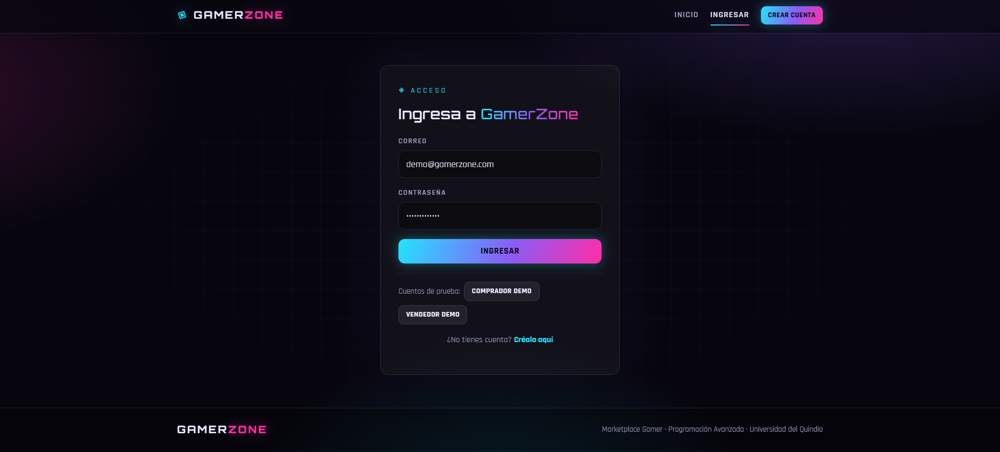
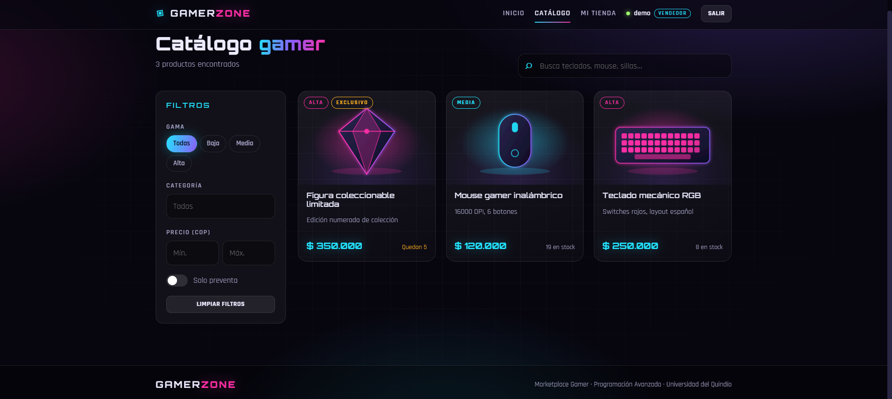
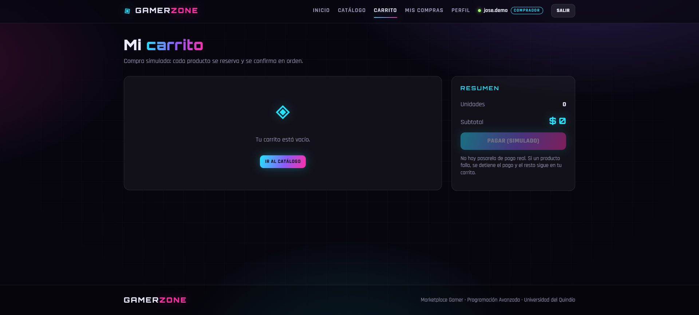
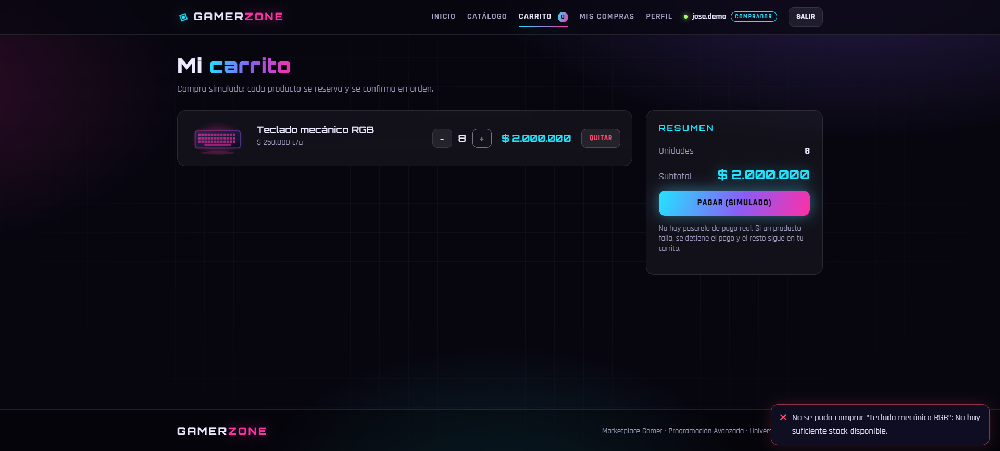
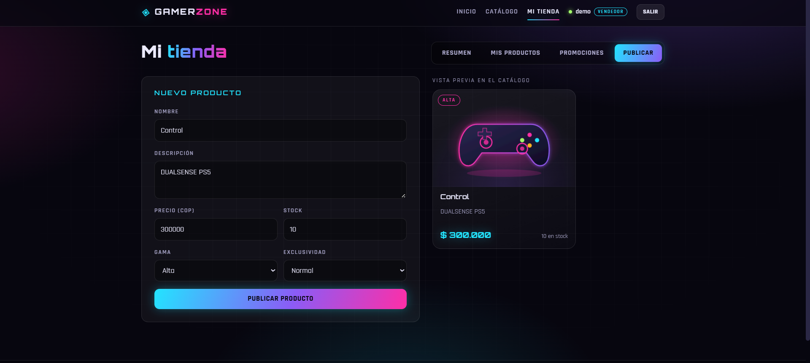
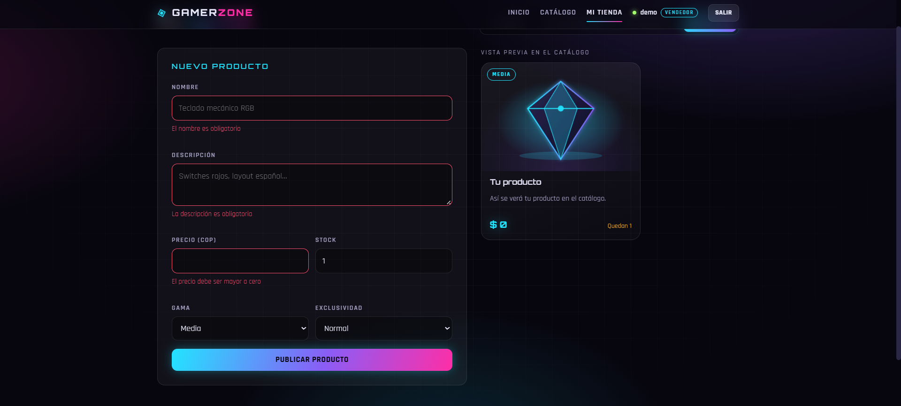
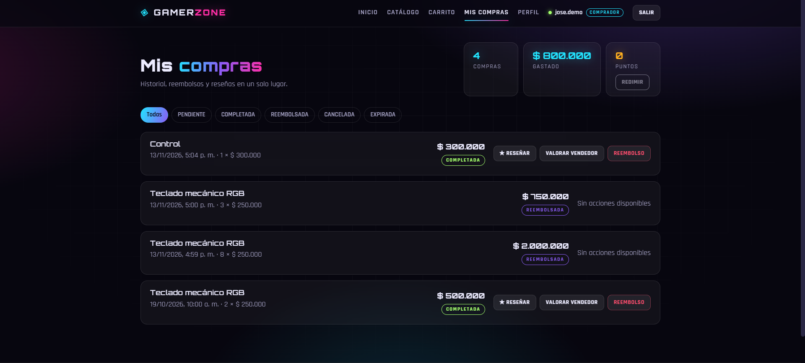

# 🎮 E-Commerce Marketplace Gamer


Sistema e-commerce descentralizado enfocado en productos y accesorios del mundo **Gaming**, desarrollado para la asignatura de Programación Avanzada / Ingeniería de Software en la **Universidad del Quindío**. El proyecto está guiado bajo los principios de **Domain-Driven Design (DDD)** y **Clean Architecture**.
 
---

## 📋 Tabla de Contenidos
1. [Integrantes y nicho](#1-integrantes-y-nicho)
2. [Cómo ejecutar el proyecto y usuarios de prueba](#2-cómo-ejecutar-el-proyecto-y-usuarios-de-prueba)
  - [2.1 Frontend, carrito y pantallas](#21-frontend-carrito-y-pantallas)
3. [Endpoints principales](#3-endpoints-principales)
4. [Correcciones de la Entrega 1](#4-correcciones-de-la-entrega-1)
5. [¿Quién compra y por qué?](#5-quién-compra-y-por-qué)
6. [¿Qué hace único a sus vendedores?](#6-qué-hace-único-a-sus-vendedores)
7. [Lenguaje Ubicuo (DDD)](#7-lenguaje-ubicuo-ddd)
8. [Reglas de Negocio e Invariantes del Dominio](#8-reglas-de-negocio-e-invariantes-del-dominio)
9. [Casos de Uso del Sistema (37 Casos de Uso)](#9-casos-de-uso-del-sistema-37-casos-de-uso)
10. [Arquitectura del Software (Clean Architecture)](#10-arquitectura-del-software-clean-architecture)
11. [Seguridad, Base de Datos y Limitaciones](#11-seguridad-base-de-datos-y-limitaciones)
12. [Cómo ejecutar las pruebas](#12-cómo-ejecutar-las-pruebas)
13. [Pruebas avanzadas](#13-pruebas-avanzadas)
14. [Gestión del Proyecto (Trello)](#14-gestión-del-proyecto-trello)

---

## 1. Integrantes y nicho

**Nicho:** Marketplace Gamer: productos y accesorios gaming (periféricos, mobiliario de setup, juegos físicos, licencias digitales y combos), con múltiples vendedores independientes.

**Integrantes:**

| Integrante | GitHub |
| :--- | :--- |
| Juan David Tapiero | `Juanda2312` |
| Santiago Torres | `ShanT237` |
| José Bedoya | `thelegendsxv` |

---

## 2. Cómo ejecutar el proyecto y usuarios de prueba

**Requisitos:** Java 21. No hace falta instalar Gradle (se usa el wrapper).

```powershell
cd backend
.\gradlew.bat bootRun          # Linux/Mac: ./gradlew bootRun
```

Por defecto usa **H2 en memoria** y carga `data.sql` al arrancar. Cuando aparezca `Started BackendApplication`, abre:

- Swagger: http://localhost:8080/swagger-ui.html
- Consola H2: http://localhost:8080/h2-console (URL JDBC: `jdbc:h2:mem:marketplacedb`, usuario `SA`)

Si el puerto 8080 está ocupado: `.\gradlew.bat bootRun --args="--server.port=8081"`.
Para MariaDB, ver la sección [11](#11-seguridad-base-de-datos-y-limitaciones).

### Usuarios de prueba (perfil H2 por defecto)

| Rol | Nombre | Correo | Contraseña |
| :--- | :--- | :--- | :--- |
| `VENDEDOR` | GamerZone | demo@gamerzone.com | `GamerZone2026` |
| `VENDEDOR` | Carlos Pérez | carlos@correo.com | `CarlosGamer2026` |
| `COMPRADOR` | Jose | jose.demo@correo.com | `JoseGamer2026` |
| `COMPRADOR` | Ana | ana.demo@correo.com | `AnaGamer2026` |

Cupón de demo: `VERANO26` (15%).

### Cómo autenticarse en Swagger

1. `POST /api/auth/login` con `{"correo": "...", "contrasena": "..."}`.
2. Copiar el valor de `token` (sin comillas).
3. Botón **Authorize** (arriba a la derecha) → pegar el token → confirmar.

Sin token la API responde `401`; con el token del rol equivocado, `403`.

### Flujo de punta a punta sugerido

1. Login como **vendedor** (`demo@gamerzone.com`) → `POST /api/productos` (publicar un producto).
2. Login como **comprador** (`jose.demo@correo.com`) → `POST /api/compras` (comprar el producto).
3. `PUT /api/compras/{id}/confirmar` → la compra queda `COMPLETADA`.
4. `POST /api/resenas` (reseñar) y `POST /api/valoraciones-vendedor` (valorar al vendedor).
5. **Error de negocio a propósito:** con `ana.demo@correo.com`, `PUT /api/compras/dddddddd-dddd-dddd-dddd-ddddddddddd2/reembolso`. Esa compra de demo supera las 48 horas del plazo, por lo que la regla del dominio rechaza el reembolso con `422`.

---

## 2.1. Frontend, carrito y pantallas

El frontend es una aplicación **Angular 21** (componentes standalone, signals y formularios reactivos) que consume la API del backend.

**Requisitos:** Node 20 o superior y el backend corriendo en `http://localhost:8080` (sección 2).

```powershell
cd frontend
npm install
npm start                      # abre http://localhost:4200
```

La URL de la API está en `frontend/src/app/config.ts` (`API_URL`); hay que cambiarla ahí al desplegar. Para entrar usa los usuarios de prueba de la sección 2: la pantalla de login tiene botones que rellenan las cuentas de demo.

### Carrito de compra simulado

Un comprador añade productos desde el modal del catálogo con **Añadir al carrito** (también puede usar **Comprar** para una compra directa). En `/carrito` ajusta las cantidades, que nunca superan el stock (un producto exclusivo admite una sola unidad), quita ítems y pulsa **Pagar (simulado)**.

No hay pasarela de pago: pagar significa crear y confirmar cada compra con los endpoints existentes (`POST /api/compras` y `PUT /api/compras/{id}/confirmar`), ítem por ítem y en orden. El proceso se detiene en el primer error: los ítems ya pagados salen del carrito y quedan `COMPLETADA`, y el ítem que falló y los pendientes se conservan. Si falla la confirmación, la reserva se cancela para devolver el stock. Mientras se procesa, el botón queda bloqueado ("Procesando…") y un segundo clic se ignora.

**Limitaciones:**

- El carrito vive solo en el navegador: no persiste al recargar la página y se vacía al cerrar sesión o cambiar de usuario.
- El pago no es transaccional: si un ítem falla, las compras que ya se confirmaron no se revierten.
- El precio del carrito es el que tenía el producto al añadirlo; el precio definitivo lo fija el backend al reservar.

### Publicar un producto (formulario reactivo)

En **Mi tienda → Publicar**, el vendedor llena un formulario reactivo que valida antes de enviar: nombre y descripción obligatorios, precio mayor a cero y stock entero de cero o más. Si hay errores no se envía ninguna petición y cada campo muestra su aviso. Al enviar, el botón queda bloqueado ("Publicando…") y, si el backend rechaza la petición, se muestra su mensaje (por ejemplo `403` si el rol no corresponde o `422` si el vendedor está dado de baja). Una vista previa muestra cómo quedará la tarjeta en el catálogo.

### Mensajes de error

Todos los errores HTTP pasan por `mensajeDeError`: se muestra el `mensaje` que manda el backend y, si no hay cuerpo, un texto por defecto según el código (`400` datos no válidos, `401` sesión no válida, `403` sin permiso, `404` no encontrado, `409` ya existe, `422` regla de negocio, `500` error del servidor y `0` sin conexión). Nunca se muestra el JSON crudo.

### Pantallas


*Login con botones para las cuentas de demo.*


*Catálogo paginado con filtros y búsqueda.*


*Carrito con cantidades limitadas por el stock y resumen del pago.*


*Pago detenido por falta de stock (`422`): el ítem se conserva y el mensaje viene del backend.*


*Formulario reactivo de publicación con vista previa de la tarjeta.*


*Avisos por campo con el formulario vacío; no se envía ninguna petición.*


*Historial de compras con sus estados y acciones (reseña, valoración, reembolso).*

### Ensayo de punta a punta

El recorrido completo (publicar, comprar con carrito, errores de negocio y de seguridad) está en [`docs/ensayo-punta-a-punta.md`](docs/ensayo-punta-a-punta.md), con el resultado esperado de cada paso. La colección de Postman equivalente para la API está en [`docs/postman/flujo-completo.json`](docs/postman/flujo-completo.json).

---

## 3. Endpoints principales

| Método y ruta | Rol | Qué hace |
| :--- | :--- | :--- |
| `POST /api/auth/login` | Público | Inicia sesión y devuelve el JWT |
| `POST /api/usuarios` | Público | Registra un comprador |
| `POST /api/vendedores` | Público | Registra un vendedor |
| `GET /api/productos` | Autenticado | Catálogo paginado con búsqueda por texto y filtros |
| `POST /api/productos` | `VENDEDOR` | Publica un producto |
| `PUT /api/productos/{id}/precio` | `VENDEDOR` | Modifica el precio |
| `PUT /api/productos/{id}/informacion` | `VENDEDOR` | Edita la información del producto |
| `PUT /api/productos/{id}/visibilidad` | `VENDEDOR` | Pausa o activa la publicación |
| `DELETE /api/productos/{id}` | `VENDEDOR` | Eliminación lógica de su producto |
| `POST /api/compras` | `COMPRADOR` | Realiza una compra |
| `GET /api/compras` | `COMPRADOR` | Historial de compras |
| `PUT /api/compras/{id}/confirmar` | `COMPRADOR` | Confirma la compra |
| `PUT /api/compras/{id}/cancelar` | `COMPRADOR` | Cancela la compra |
| `PUT /api/compras/{id}/reembolso` | `COMPRADOR` | Solicita reembolso (48 h, sin descarga) |
| `PUT /api/compras/{id}/cupon` | `COMPRADOR` | Aplica un cupón |
| `POST /api/resenas` | `COMPRADOR` | Reseña una compra completada |
| `POST /api/valoraciones-vendedor` | `COMPRADOR` | Valora al vendedor |
| `POST /api/wishlists` · `DELETE /api/wishlists/{productoId}` | `COMPRADOR` | Añade o quita de la wishlist |
| `GET /api/reportes/ventas` | `VENDEDOR` | Reporte de ventas del vendedor |
| `GET /api/reportes/mas-vendidos` | Autenticado | Ranking de más vendidos (JOIN + GROUP BY) |

La lista completa está en Swagger y en [`backend/Docs/api/mapeo-dominio-api.md`](backend/Docs/api/mapeo-dominio-api.md).

---

## 4. Correcciones de la Entrega 1

| Observación que nos dieron | Qué cambiamos | Dónde se ve |
| :--- | :--- | :--- |
| Las entidades del dominio tenían el **constructor público**: cualquiera podía crear un objeto sin pasar por las validaciones y dejarlo en estado inválido. | Los constructores pasaron a `private`. La creación se hace solo con métodos de fábrica estáticos que validan las invariantes (`Producto.publicar`, `Usuario.registrar`, `Compra.realizar`, `Wishlist.crear`, `Vendedor.registrar`, `Combo.crear`, `Preventa.programar`...). | Rama `fix/corrections` (PR #18). Commits del 11/10: `e61f066` (Producto), `04e75f5` (Usuario), `0b14a99` (Compra), `5376af7` (Wishlist), `e1b7def` (Vendedor), `40ba7ed` (Combo), `8c2f707` (Preventa). Código actual en `domain/entity/`. |

**Por qué es mejor:** la regla de negocio queda en un solo punto, dentro del propio objeto del dominio, y es imposible saltársela desde un caso de uso o un controller.

**Consecuencia para la persistencia:** como el constructor es privado, el mapper JPA no puede crear la entidad directamente. Por eso se agregó un método `reconstruir(...)` en cada entidad (commits del 19 al 21/10), que rehidrata el objeto desde la base de datos sin abrir el constructor al resto del código.

**Value Objects:** los VO (`Precio`, `Puntos`, `Unidades`, `Calificacion`...) son `record` de Java. Su constructor canónico es público, pero es seguro porque el `record` es inmutable y valida sus invariantes en el constructor compacto: un VO inválido nunca llega a existir.

---

## 5. ¿Quién compra y por qué?

El marketplace está diseñado conceptualmente para atender las necesidades específicas de la comunidad gamer:

- 🎮 **Gamers:** buscan productos de alto rendimiento que mejoren su experiencia competitiva (periféricos de alta precisión, componentes de hardware, sillas ergonómicas y accesorios dedicados).
- 🎥 **Streamers / Creadores de Contenido:** buscan productos funcionales y estéticamente atractivos (iluminación RGB, placas de captura, micrófonos condensadores, mobiliario) para personalizar sus setups de transmisión.
- 🕹️ **Jugadores Casuales:** buscan productos accesibles que garanticen confort, entretenimiento y una experiencia de juego amigable en su tiempo libre.
---

## 6. ¿Qué hace único a sus vendedores?

El sistema opera como un **marketplace multi-vendedor**, donde diversos comercios independientes pueden registrarse, gestionar su reputación y publicar su propia oferta comercial.

Categorías habilitadas en el catálogo:

- 🖱️ **Periféricos:** mouses, teclados mecánicos, audífonos Surround 7.1, mandos y mousepads XL.
- 🪑 **Mobiliario & Setup:** sillas ergonómicas, escritorios regulables, soportes de monitor e iluminación inteligente.
- 🎮 **Juegos Físicos & Coleccionables:** títulos en formato físico, figuras de acción y preventas exclusivas.
- 💻 **Licencias & Códigos Digitales:** claves para videojuegos, pases de batalla, gift cards y suscripciones.
- 🎁 **Combos Gamer:** paquetes promocionales de 2 o más productos ofrecidos a precio preferencial.
---

## 7. Lenguaje Ubicuo (DDD)

| Término | Definición en el Dominio |
| :--- | :--- |
| **Gama** | Clasificación técnica del producto según prestaciones y precio (`BAJA`, `MEDIA`, `ALTA`). |
| **Preventa** | Modalidad de compra anticipada habilitada antes de la fecha de liberación oficial del producto. |
| **Wishlist** | Lista de deseos personal para seguimiento de precios, promociones y disponibilidad de stock. |
| **Notificación** | Alerta que recibe el usuario cuando un producto de su Wishlist baja de precio (descuento). |
| **Combo** | Agrupación promocional de 2 o más productos comercializados bajo una sola entidad con descuento. |
| **Usuario** | Persona registrada que compra, reseña, acumula y redime puntos. Se llama *Usuario* en todo el código. |
| **Vendedor** | Entidad comercial (Persona Natural o Empresa) registrada para publicar y vender productos. |
| **Puntos de Fidelización** | Unidades de beneficio otorgadas a compradores tras publicar reseñas de compras completadas. |
| **Regalo** | Beneficio otorgado por el sistema al usuario tras alcanzar metas de compra acumuladas. |
| **Exclusividad** | Condición de un producto especial: cada usuario puede comprarlo una sola vez y de a una unidad. |
| **Unidades** | Cantidad disponible de un producto para su venta (nunca negativa; cero significa agotado). |
 
---

## 8. Reglas de Negocio e Invariantes del Dominio

| # | Regla | Dónde se garantiza | Estado |
|---|---|---|---|
| 1 | Un producto nunca tiene stock negativo; se restituye al cancelar o reembolsar. | `Producto.reducirStock` / `aumentarStock` | ✅ |
| 2 | Solo se reseña una compra `COMPLETADA`; una reseña por usuario y producto. | `Compra.registrarResena`, `Resena.crear`, `SubirResenaUseCase` | ✅ |
| 3 | No se elimina un producto con compras activas (`PENDIENTE` o `COMPLETADA`); la eliminación es lógica. | `Producto.eliminar`, `EliminarProductoUseCase` | ✅ |
| 4 | Un producto en preventa no se compra antes de su fecha de lanzamiento. | `Preventa.validarAcceso`, `RealizarCompraUseCase` | ✅ |
| 5 | Un combo tiene dos o más productos distintos y su descuento es menor a 100%. | `Combo.crear`, `agregarProducto`, `quitarProducto`, `CrearComboUseCase`, `ModificarProductosComboUseCase` | ✅ |
| 6 | Los puntos se asignan solo después de reseñar, y una sola vez. | `Compra.asignarPuntos`, `SubirResenaUseCase` | ✅ |
| 7 | Un producto no se repite en la Wishlist ni se agregan productos eliminados. | `Wishlist.agregarProducto`, `AnadirAWishlistUseCase` | ✅ |
| 8 | Solo se notifica a quienes tienen el producto en su Wishlist, y solo cuando hay descuento. | `Producto.aplicarDescuento`, `AplicarDescuentoUseCase`, `NotificarDescuentoWishlistUseCase` | ✅ |
| 9 | Un producto exclusivo se compra una sola vez por usuario y de a una unidad. | `Producto.validarCompraExclusiva` | ✅ |
| 10 | Un regalo solo se elige para quien no posee el producto, y sigue DISPONIBLE → ELEGIDO → ENVIADO → ENTREGADO. | `Regalo`, `EnviarRegaloUseCase`, `ConfirmarEntregaRegaloUseCase` | ✅ |

### Reglas adicionales que el código garantiza

- El reembolso solo procede si la compra está `COMPLETADA`, dentro de **48 horas**, sin descarga y sin puntos asignados.
- `REEMBOLSADA`, `CANCELADA` y `EXPIRADA` son estados finales de una compra.
- La fecha de la compra y los ids los genera el servidor, no el cliente.
- Un vendedor dado de baja no puede publicar y sus productos no se pueden comprar.
- Un producto pausado o eliminado no se puede comprar; solo el vendedor dueño modifica, edita, pausa o programa promociones de su producto.
- Una `Promocion` tiene vigencia (fechas inclusive), no se solapa con otra del mismo producto y no cambia el precio base.
- Un cupón es válido hasta su fecha de vencimiento y mientras tenga usos; se aplica una sola vez, solo a compras `PENDIENTE` (el precio se congela al confirmar).
- Comprar un combo valida todos sus productos antes de descontar stock: si uno falla, no se modifica ninguno.
- Una `MetaRecompensa` exige un umbral de compras positivo y se desactiva una sola vez (nunca se borra).
- El vendedor se valora una vez por compra completada. La comisión del marketplace es 5% de los ingresos completados.
- Las contraseñas (de compradores y vendedores) exigen 8+ caracteres, mayúscula y número, y solo se guarda su hash (BCrypt). La sesión usa JWT HS256 con el rol en el token (`COMPRADOR` o `VENDEDOR`) y `/api/**` exige token salvo `/api/auth/**` y los `POST` de registro.
- El id del comprador o vendedor sale siempre del token, nunca del body ni de la URL; cada ruta valida el rol con `@PreAuthorize`.
- La búsqueda de catálogo es paginada (`size` entre 1 y 100) y solo lista productos visibles (no eliminados ni pausados).
- Los errores de dominio responden 422, la duplicidad 409 y las validaciones de datos 400; 401 y 403 devuelven un cuerpo JSON.
---

## 9. Casos de Uso del Sistema (37 Casos de Uso)

**Leyenda:** ✅ Implementado (caso de uso y pruebas) · 🟡 Parcial · ⏳ Especificado, pendiente de implementar.

### 📈 Resumen de avance

| Módulo | ✅ Implementados | 🟡 Parciales | ⏳ Especificados | Total |
| :--- | :---: | :---: | :---: | :---: |
| Compras y Checkout | 6 | 0 | 0 | 6 |
| Productos y Catálogo | 9 | 0 | 0 | 9 |
| Combos Promocionales | 2 | 0 | 0 | 2 |
| Reseñas, Puntos y Recompensas | 4 | 0 | 0 | 4 |
| Lista de Deseos (Wishlist) y Notificaciones | 3 | 0 | 0 | 3 |
| Usuarios, Vendedores y Autenticación | 5 | 0 | 0 | 5 |
| Consultas, Métricas y Reportes | 8 | 0 | 0 | 8 |
| **Total** | **37** | **0** | **0** | **37** |

### 🛒 Módulo 1: Compras y Checkout
| Código | Caso de Uso | Estado Código | Actor | Descripción |
| :--- | :--- | :--- | :--- | :--- |
| `CU-01` | **Realizar Compra** | ✅ Implementado | Comprador | Registra la orden `PENDIENTE`, reserva stock y valida producto no eliminado, usuario y vendedor activos, exclusividad y fecha de preventa, usando la fecha del servidor (`RealizarCompraUseCase`). |
| `CU-09` | **Confirmar Compra** | ✅ Implementado | Comprador / Sistema | Valida el pago y pasa la orden a `COMPLETADA` (`ConfirmarCompraUseCase`). |
| `CU-12` | **Cancelar Compra** | ✅ Implementado | Comprador | Pasa la orden a `CANCELADA` y devuelve automáticamente el stock retenido al producto (`CancelarCompraUseCase`). |
| `CU-13` | **Solicitar Reembolso** | ✅ Implementado | Comprador | Solicita reembolso dentro de 48 horas, sin descarga y sin puntos asignados; pasa a `REEMBOLSADA` y restituye el stock (`SolicitarReembolsoUseCase`). |
| `CU-16` | **Comprar Combo** | ✅ Implementado | Comprador | Permite adquirir un combo verificando stock de todos sus integrantes. (`ComprarComboUseCase`). |
| `CU-17` | **Aplicar Cupón de Descuento** | ✅ Implementado | Comprador | Aplica un código promocional al total del pago previo al checkout. (`AplicarCuponUseCase`). |

### 📦 Módulo 2: Productos y Catálogo
| Código | Caso de Uso | Estado Código | Actor | Descripción |
| :--- | :--- | :--- | :--- | :--- |
| `CU-04` | **Publicar Producto** | ✅ Implementado | Vendedor | Crea un nuevo producto especificando gama, precio, stock y atributos; expuesto en `POST /api/productos` (`PublicarProductoUseCase`, `ProductoController`). |
| `CU-05` | **Modificar Producto** | ✅ Implementado | Vendedor | Actualiza precio, descripción o disponibilidad de preventa. (`ModificarProductoUseCase`). |
| `CU-06` | **Eliminar Producto** | ✅ Implementado | Vendedor | Desactiva el producto preservando trazabilidad; rechaza la baja si hay compras activas (`EliminarProductoUseCase`). |
| `CU-18` | **Gestionar / Aumentar Stock** | ✅ Implementado (Dominio) | Vendedor | Incrementa las unidades disponibles en inventario (`Producto.aumentarStock`, usado al cancelar y reembolsar). |
| `CU-19` | **Editar Información General** | ✅ Implementado | Vendedor | Actualiza detalles secundarios e imágenes del producto. (`EditarInformacionProductoUseCase`). |
| `CU-20` | **Filtrar y Buscar Productos** | ✅ Implementado | Comprador | Búsqueda avanzada y paginada por texto, gama, categoría, precio y preventas; filtros y paginación se resuelven en la base de datos. (`BuscarProductosUseCase`). |
| `CU-21` | **Activar / Pausar Publicación** | ✅ Implementado | Vendedor | Alterna la visibilidad del producto en el catálogo sin borrarlo. (`CambiarVisibilidadProductoUseCase`). |
| `CU-22` | **Configurar Descuento Promocional** | ✅ Implementado | Vendedor | Aplica un porcentaje de descuento a un producto y notifica a quienes lo tienen en su Wishlist (`AplicarDescuentoUseCase`). La vigencia temporal la maneja `Promocion` (el precio base no cambia). (`ConfigurarDescuentoPromocionalUseCase`). |
| `CU-37` | **Programar Preventa** | ✅ Implementado | Vendedor | Programa una preventa con fecha de lanzamiento futura, un producto del vendedor y sin preventa duplicada (`ProgramarPreventaUseCase`). `RealizarCompraUseCase` respeta esa fecha (Regla 4). |

### 🎁 Módulo 3: Combos Promocionales
| Código | Caso de Uso | Estado Código | Actor | Descripción |
| :--- | :--- | :--- | :--- | :--- |
| `CU-07` | **Crear Combo Gamer** | ✅ Implementado | Vendedor | Agrupa 2 o más productos del vendedor, sin duplicados y con descuento menor a 100% (`CrearComboUseCase`, `Combo.crear`). |
| `CU-23` | **Modificar Productos de Combo** | ✅ Implementado | Vendedor | Añade o remueve productos garantizando el mínimo de 2 unidades (`ModificarProductosComboUseCase`). |

### ⭐ Módulo 4: Reseñas, Puntos y Recompensas
| Código | Caso de Uso | Estado Código | Actor | Descripción |
| :--- | :--- | :--- | :--- | :--- |
| `CU-02` | **Subir Reseña y Asignar Puntos** | ✅ Implementado | Comprador | Publica reseña sobre compra completada, valida 1 reseña por usuario/producto y asigna puntos (`SubirResenaUseCase`). |
| `CU-08` | **Redimir Puntos por Beneficios** | ✅ Implementado | Comprador | Canjea puntos acumulados con validación de saldo positivo (`RedimirPuntosUseCase`, `Usuario.redimirPuntos`). |
| `CU-10` | **Asignar Regalo por Meta** | ✅ Implementado | Admin / Sistema | Asigna un regalo disponible al usuario por cada 5 compras `COMPLETADA`, siempre que no posea ya el producto (o alguno de los del combo) (`AsignarRegaloPorMetaUseCase`). |
| `CU-24` | **Enviar / Confirmar Entrega Regalo** | ✅ Implementado | Admin / Sistema / Comprador | Administra el cambio de estado del regalo: el envío exige que esté elegido y la entrega la confirma solo el destinatario (`EnviarRegaloUseCase`, `ConfirmarEntregaRegaloUseCase`). |

### ❤️ Módulo 5: Lista de Deseos (Wishlist) y Notificaciones
| Código | Caso de Uso | Estado Código | Actor | Descripción |
| :--- | :--- | :--- | :--- | :--- |
| `CU-03` | **Añadir a Wishlist** | ✅ Implementado | Comprador | Guarda productos en la wishlist evitando duplicados y rechazando eliminados (`AnadirAWishlistUseCase`). |
| `CU-14` | **Notificar Descuento en Wishlist** | ✅ Implementado | Sistema | Genera notificaciones por descuento para quienes tienen el producto en su Wishlist (`NotificarDescuentoWishlistUseCase`). |
| `CU-15` | **Quitar de Wishlist** | ✅ Implementado | Comprador | Elimina un producto específico de la lista de deseos (`QuitarDeWishlistUseCase`). |

### 👤 Módulo 6: Usuarios, Vendedores y Autenticación
| Código | Caso de Uso | Estado Código | Actor | Descripción |
| :--- | :--- | :--- | :--- | :--- |
| `CU-11` | **Registrar Usuario / Vendedor** | ✅ Implementado | Público | Registro de compradores (correo único) y de vendedores (documento único, cédula o NIT) (`RegistrarUsuarioUseCase`, `RegistrarVendedorUseCase`). |
| `CU-25` | **Dar de Baja Vendedor** | ✅ Implementado | Admin / Vendedor | Baja lógica del vendedor conservando la historia comercial (`DarDeBajaVendedorUseCase`). |
| `CU-26` | **Editar Perfil y Seguridad** | ✅ Implementado | Usuario | Modificación de nombre, correo y contraseña. (`EditarPerfilUseCase`, `CambiarContrasenaUseCase`). |
| `CU-27` | **Iniciar Sesión (JWT)** | ✅ Implementado | Todos | Autenticación con token JWT seguro para el acceso a las APIs. (`IniciarSesionUseCase`, `AuthController`). |
| `CU-28` | **Valorar Vendedor** | ✅ Implementado | Comprador | Calificación directa del servicio y atención brindada por el vendedor. (`ValorarVendedorUseCase`). |

### 📊 Módulo 7: Consultas, Métricas y Reportes
| Código | Caso de Uso | Estado Código | Actor | Descripción |
| :--- | :--- | :--- | :--- | :--- |
| `CU-29` | **Reporte de Ventas por Vendedor** | ✅ Implementado | Vendedor | Balance de ingresos, unidades vendidas y comisiones. (`ReporteVentasVendedorUseCase`). |
| `CU-30` | **Reporte de Productos Más Vendidos** | ✅ Implementado | Admin / Vendedor | Escalafón de productos con mayor volumen de venta y calificación, agrupado y ordenado en la base de datos. (`ReporteMasVendidosUseCase`). |
| `CU-31` | **Consultar Historial de Compras** | ✅ Implementado | Comprador | Muestra las compras del usuario, la más reciente primero (`ConsultarHistorialComprasUseCase`). |
| `CU-32` | **Consultar Historial de Puntos** | ✅ Implementado | Comprador | Detalle de saldo de puntos ganados y redimidos. (`ConsultarHistorialPuntosUseCase`). |
| `CU-33` | **Gestionar Metas de Recompensas** | ✅ Implementado | Admin | Configura umbrales de compras para desbloquear regalos. (`GestionarMetasRecompensaUseCase`). |
| `CU-34` | **Alertas de Stock Bajo** | ✅ Implementado | Vendedor | Reporte de inventario crítico o agotado para reabastecimiento. (`AlertasStockBajoUseCase`). |
| `CU-35` | **Métricas de Reseñas** | ✅ Implementado | Admin / Vendedor | Dashboard de satisfacción del cliente y calificaciones. (`MetricasResenasUseCase`). |
| `CU-36` | **Reporte Global del Marketplace** | ✅ Implementado | Admin | Consolidado ejecutivo del volumen total de operaciones. (`ReporteGlobalUseCase`). |
 
---

## 10. Arquitectura del Software (Clean Architecture)

El backend en Java 21 / Spring Boot implementa **Clean Architecture** estructurado en capas desacopladas.

### Raíces de agregado para la sustentación

- **Producto**: raíz del agregado de catálogo e inventario. Protege invariantes como stock no negativo, baja lógica y visibilidad. El vendedor se referencia por `vendedorId`; no se carga como parte de este agregado.
- **Compra**: raíz del agregado de compra. Controla cantidad, precio unitario congelado y transiciones de estado, además de las reglas de reseña, puntos y reembolso. Referencia `usuarioId` y `productoId` sin contener esos agregados.
  Los casos de uso coordinan cambios que afectan a más de un agregado; cada entidad protege sus propias reglas. Las entidades JPA son adaptadores de persistencia separados de estas raíces de dominio.

```
backend/src/main/java/com/uniquindio/backend/
├── domain/                  # Capa de Dominio (Sin dependencias de frameworks)
│   ├── entity/              # Entidades Raíz de Agregados (Producto, Compra, Vendedor, Usuario, Regalo, Resena, Wishlist, Combo, Preventa, Notificacion, Promocion, Cupon, MetaRecompensa, MovimientoPuntos, ValoracionVendedor)
│   ├── valueobject/         # Objetos de Valor (Gama, EstadoCompra, EstadoRegalo, TipoVendedor, TipoNotificacion, Precio, Puntos, Unidades, Calificacion, Exclusividad, FiltroProducto, Pagina, Contrasena, TipoMovimientoPuntos, Rol)
│   ├── repository/          # Interfaces de Repositorio de Dominio (incluye CatalogoRepository)
│   ├── service/             # Puertos del dominio (EmisorToken, HashContrasena, SesionToken)
│   └── exception/           # Excepciones de Negocio (ReglaDominioException, ConflictoException, AutenticacionException)
├── application/             # Capa de Aplicación (Casos de Uso)
│   ├── usecase/             # Lógica de Orquestación (37 casos de uso)
│   │   ├── Compras:   RealizarCompra, ConfirmarCompra, CancelarCompra, SolicitarReembolso, ConsultarHistorialCompras
│   │   ├── Productos: PublicarProducto, EliminarProducto, AplicarDescuento, ProgramarPreventa
│   │   ├── Combos:    CrearCombo, ModificarProductosCombo
│   │   ├── Reseñas y recompensas: SubirResena, RedimirPuntos, EnviarRegalo, ConfirmarEntregaRegalo, AsignarRegaloPorMeta
│   │   ├── Wishlist:  AnadirAWishlist, QuitarDeWishlist, NotificarDescuentoWishlist
│   │   ├── Cuentas:   RegistrarUsuario, RegistrarVendedor, DarDeBajaVendedor, IniciarSesion, EditarPerfil, CambiarContrasena, ValorarVendedor
│   │   ├── Catálogo:  ModificarProducto, EditarInformacionProducto, CambiarVisibilidadProducto, BuscarProductos, ConfigurarDescuentoPromocional
│   │   ├── Promos:    AplicarCupon, ComprarCombo, GestionarMetasRecompensa, ConsultarHistorialPuntos
│   │   └── Reportes:  ReporteVentasVendedor, ReporteMasVendidos, AlertasStockBajo, MetricasResenas, ReporteGlobal
│   ├── port/out/            # Puertos de salida de consulta (ReporteMasVendidosPort)
│   └── dto/                 # Data Transfer Objects (request y response)
└── infrastructure/          # Capa de Infraestructura (Spring Boot / Controller / Persistence)
    ├── rest/                # Controladores REST (uno por recurso), mappers y GlobalExceptionHandler
    ├── persistence/         # Repositorios JPA (H2 / MariaDB) y en memoria, con sus mappers de persistencia
    ├── security/            # JwtEmisorToken, JwtAuthenticationFilter, BCryptHashContrasena y RespuestaErrorSeguridad
    └── config/              # ClockConfig, SecurityConfig (JWT y CORS) y OpenApiConfig
```
 
---

## 11. Seguridad, Base de Datos y Limitaciones

### Seguridad

La API usa Spring Security con JWT (jjwt, HS256). El login (CU-27) autentica compradores y vendedores y emite un token con el rol (`COMPRADOR` o `VENDEDOR`). `/api/**` exige token, salvo `/api/auth/**` y los `POST` de registro.

Los controllers leen el id del `Authentication` (token), nunca del body ni de la URL, por lo que un usuario no puede actuar sobre recursos de otro. Cada ruta restringe el rol con `@PreAuthorize`: un rol equivocado recibe 403.

CORS está habilitado para el frontend en desarrollo (`localhost:4200` y `localhost:3000`) dentro de la cadena de seguridad, de modo que el preflight `OPTIONS` se responde sin exigir token.

En desarrollo el secreto JWT tiene un valor por defecto; en producción debe definirse la variable de entorno `JWT_SECRET` (mínimo 32 caracteres).

### Base de datos y consultas

El perfil predeterminado usa H2 en memoria para desarrollo y pruebas, con datos de demo cargados desde `data.sql`. Para MariaDB, crear la base `ecommerce_productos_gamer` y arrancar desde `backend` con el perfil `mariadb`.

PowerShell:

```powershell
$env:DB_URL = "jdbc:mariadb://localhost:3306/ecommerce_productos_gamer"
$env:DB_USERNAME = "usuario"
$env:DB_PASSWORD = "contraseña"
.\gradlew.bat bootRun --args="--spring.profiles.active=mariadb"
```

Bash:

```bash
DB_URL=jdbc:mariadb://localhost:3306/ecommerce_productos_gamer \
DB_USERNAME=usuario DB_PASSWORD=contraseña \
./gradlew bootRun --args='--spring.profiles.active=mariadb'
```

El perfil `mariadb` no carga los datos de demo (`spring.sql.init.mode=never`): los usuarios y vendedores se crean con los endpoints de registro.

El catálogo se busca con `GET /api/productos?texto=mouse&categoria=Perifericos&page=0&size=20`; la respuesta contiene `contenido`, `pagina`, `tamano`, `totalElementos` y `totalPaginas`. `GET /api/reportes/mas-vendidos` agrupa ventas completadas en la base de datos.

### Limitaciones

- **No existe un rol ADMIN.** Las metas de recompensa y el envío de regalos (CU-24) quedan restringidos a `VENDEDOR`, aunque conceptualmente son de administración; cualquier vendedor puede enviar cualquier regalo.
- `GET /api/reportes/mas-vendidos` y `GET /api/reportes/global` están abiertos a cualquier sesión autenticada (son estadísticas del marketplace).
- El carrito del frontend no persiste (ver la sección [2.1](#21-frontend-carrito-y-pantallas)) y el pago simulado no revierte las compras ya confirmadas si un ítem posterior falla.
  Los endpoints de cada operación están en [`backend/Docs/api/mapeo-dominio-api.md`](backend/Docs/api/mapeo-dominio-api.md) y en Swagger (`http://localhost:8080/swagger-ui.html`, botón **Authorize** para pegar el token del login).

---

## 12. Cómo ejecutar las pruebas

```powershell
cd backend
.\gradlew.bat test      # Linux/Mac: ./gradlew test
```

Pruebas del frontend (Vitest) y compilación:

```powershell
cd frontend
npx ng test --watch=false
npx ng build
```
 
---

## 13. Pruebas avanzadas

En esta parte agregamos pruebas para revisar que el backend no solo funcione por encima, sino que también guarde bien la información y responda como debe cuando alguien intenta hacer algo que no puede. Para organizarlas usamos el patrón AAA: primero preparamos los datos, después ejecutamos la acción y al final revisamos si pasó lo que esperábamos. Las pruebas se ejecutan con `./gradlew test`.

### Dónde está cada prueba

| Punto del seguimiento | Clase de prueba |
| :--- | :--- |
| 0. Guardar, consultar y revisar consultas del repositorio | `ConsultasCatalogoJpaTest`, `VendedorRepositoryJpaTest`, `PersistenciaSecundariaJpaTest` |
| 1. Endpoint con seguridad | `ProductoControllerTest`, `ReporteControllerTest` |
| 2. Pruebas con `@DataJpaTest` | `ConsultasCatalogoJpaTest`, `VendedorRepositoryJpaTest`, `PersistenciaSecundariaJpaTest` |
| 3. Prueba de integración | `integracion/FlujoCompletoIntegracionTest` |
| 4. Error 404 y regla de negocio | `EliminarProductoControllerTest` |
| 5. Errores HTTP de compra y publicación (401, 422 y 400) | `integracion/FlujoCompletoIntegracionTest` |

### 0. Pruebas del repositorio

Con estas pruebas revisamos que la información sí se guarde y después se pueda consultar sin que se pierdan los datos. También comprobamos consultas del catálogo y de vendedores usando datos que conocemos, para saber cuántos resultados deberían salir y en qué orden. Esto sirve porque no basta con que el programa diga que guardó algo: también toca mirar que al recuperarlo los datos sigan bien, incluyendo los objetos de valor que usa el dominio. Para esta parte usamos pruebas de persistencia con `@DataJpaTest`, que nos deja probar esa zona sin tener que levantar toda la aplicación.

### 1. Probar un endpoint con seguridad

Probamos `POST /api/productos`, que es una ruta para publicar productos y que debe usar un vendedor. La idea es revisar tres situaciones: si no se manda token, la API responde `401`; si se entra como comprador, que no tiene permiso para publicar, responde `403`; y si se entra como vendedor, la petición se acepta. En este último caso devuelve `201`, porque se está creando un producto nuevo. Para estas pruebas usamos `SesionTest`, que nos ayuda a preparar una sesión con el rol que necesitamos. Así revisamos que la seguridad no dependa solo de que alguien esté conectado, sino también de que tenga el permiso correcto.

### 2. `@DataJpaTest` contra `@SpringBootTest`

Por lo que entendimos, `@DataJpaTest` sirve para probar la parte que maneja los datos, como los repositorios y las consultas, sin cargar todos los componentes del sistema. En cambio, `@SpringBootTest` levanta una parte mucho más completa de la aplicación, por ejemplo los controllers, los casos de uso y la seguridad. Por eso usamos `@DataJpaTest` en las pruebas de repositorio y `@SpringBootTest` para revisar flujos más completos. Cuando trabajamos con Spring Boot 4, vimos que `@DataJpaTest` cambió de paquete y que también hacía falta agregar una dependencia de pruebas aparte. Lo resolvimos agregando `spring-boot-starter-data-jpa-test` al `build.gradle` y usando el import nuevo de la anotación.

### 3. Prueba de integración

Una prueba unitaria revisa una parte pequeña del código por separado, mientras que una prueba de integración mira si varias partes trabajan bien juntas. En `FlujoCompletoIntegracionTest` usamos `@SpringBootTest` y `MockMvc` para recorrer el flujo real desde la petición, pasando por la seguridad, el controller y el caso de uso, hasta llegar al repositorio y a la base de datos H2. No usamos mocks para reemplazar esas partes del flujo. Probamos, por ejemplo, que un vendedor publique un producto y que un comprador pueda comprarlo, confirmar la compra y verla en su historial. También revisamos que un reembolso fuera del tiempo permitido sea rechazado. Estas pruebas sirven para encontrar problemas entre componentes, aunque tardan más que las unitarias, así que conviene usarlas en los procesos más importantes.

### 4. Más casos en el controller

También agregamos casos donde la petición no debería terminar guardando información. Uno revisa qué pasa cuando se intenta eliminar un producto que no existe y la API devuelve un `404`. El otro revisa una regla de negocio que impide eliminar un producto cuando tiene compras activas. En los dos casos usamos `verify(..., never())` para comprobar que el método de guardar no se haya llamado. Esto es importante porque no sería suficiente con que la API devuelva un error: también tenemos que comprobar que no haya hecho un cambio que no debía hacer.

### 5. Errores HTTP de compra y publicación

El frontend le muestra al usuario el `mensaje` que manda el backend, así que fijamos con pruebas de integración los códigos y mensajes que consume. En `FlujoCompletoIntegracionTest`: comprar más unidades que el stock responde `422` con "No hay suficiente stock disponible" y el stock del producto no cambia en la base; comprar sin token responde `401`; y publicar con el nombre vacío y un precio negativo responde `400` con un mensaje que nombra el campo. Los mismos casos están en la carpeta B de la colección de Postman (`docs/postman/flujo-completo.json`). En el frontend, las pruebas con Vitest cubren `mensajeDeError`, el carrito (incluido el pago secuencial y el doble clic) y el formulario de publicación (validación, botón bloqueado y errores del servidor).

## 14. Gestión del Proyecto (Trello)

El avance del proyecto se gestiona en un tablero público de Trello:

👉 **[Marketplace Gamer — Backend & DDD](https://trello.com/b/pmz32QJB/marketplace-gamer-backend-ddd-entrega-1)**

**Listas del tablero**

| Lista | Qué contiene |
| :--- | :--- |
| 📥 Backlog / Por Hacer | Casos de uso y tareas técnicas pendientes. |
| ⚙️ En Proceso | Trabajo en desarrollo. |
| 🔍 En Revisión / Code Review | Trabajo terminado a la espera de revisión del equipo. |
| ✅ Completado | Trabajo implementado y revisado. |

**Etiquetas:** `Caso de Uso`, `Comprador`, `Vendedor` e `Infraestructura`.

**Convención de códigos:** cada tarjeta de caso de uso se llama `[CU-xx] Nombre` y usa el mismo código de la sección 9 de este README (por ejemplo, `[CU-22] Aplicar Descuento a Producto`). Las tareas técnicas llevan un prefijo propio, como `[PERSISTENCIA]`, `[DTO]`, `[Dominio]` o `[Doc]`.
